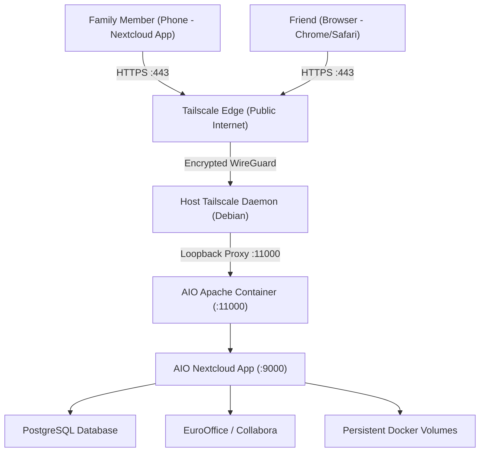

# Production Deployment Guide: Nextcloud AIO on Debian Host

This guide explains how to set up a 24/7 private family cloud server on a dedicated **Debian** machine using **Nextcloud All-in-One (AIO)** and **Tailscale Funnel**.

---

## 1. Architecture Overview



### Why this architecture?
1. **Zero Router Port Forwarding**: Eliminates WAN port forwarding and protects your home IP address.
2. **No VPN App Required for Friends**: Tailscale Funnel makes the trusted `*.ts.net` domain public over HTTPS. Anyone on mobile data or any Wi-Fi can connect.
3. **Admin Approval Protection**: Anyone can view the registration page, but **zero access** is granted until the administrator clicks "Approve".
4. **Valid TLS Certificate**: Backed by Let's Encrypt certificates managed automatically by Tailscale.

---

## 2. Quick Automated Deployment

If you want to run the automated installer on a fresh Debian machine:

```bash
# 1. Download or copy the files to your server
git clone <your-repo> /opt/nextcloud-aio || mkdir -p /opt/nextcloud-aio
cd /opt/nextcloud-aio

# 2. Make the installer executable and run
chmod +x install-nextcloud.sh enable-registration.sh
sudo ./install-nextcloud.sh
```

---

## 3. Manual Step-by-Step Walkthrough

### Step 1: Base Packages & Docker Engine Installation
```bash
sudo apt update && sudo apt upgrade -y
sudo apt install -y curl ufw jq apt-transport-https ca-certificates gnupg lsb-release

# Install Docker repository and GPG key
sudo install -m 0755 -d /etc/apt/keyrings
curl -fsSL https://download.docker.com/linux/debian/gpg | sudo gpg --dearmor -o /etc/apt/keyrings/docker.gpg
sudo chmod a+r /etc/apt/keyrings/docker.gpg

echo \
  "deb [arch=$(dpkg --print-architecture) signed-by=/etc/apt/keyrings/docker.gpg] https://download.docker.com/linux/debian \
  $(. /etc/os-release && echo "$VERSION_CODENAME") stable" | \
  sudo tee /etc/apt/sources.list.d/docker.list > /dev/null

sudo apt update
sudo apt install -y docker-ce docker-ce-cli containerd.io docker-buildx-plugin docker-compose-plugin
sudo systemctl enable --now docker
```

### Step 2: Configure Debian Firewall (UFW)
```bash
sudo ufw allow 22/tcp comment 'SSH'
sudo ufw allow 8080/tcp comment 'AIO Setup'
sudo ufw allow 11000/tcp comment 'AIO Apache Proxy'
sudo ufw enable
```

### Step 3: Install & Authenticate Tailscale
```bash
curl -fsSL https://tailscale.com/install.sh | sh
sudo systemctl enable --now tailscaled

# Log in to your tailnet
sudo tailscale up

# Note your full domain (e.g. debian.tail12345.ts.net)
sudo tailscale status
```

> [!IMPORTANT]
> Go to the [Tailscale Admin Console](https://login.tailscale.com/admin/dns):
> 1. Ensure **MagicDNS** is turned **ON**.
> 2. Under **HTTPS Certificates**, click **Enable HTTPS Certificates**.

### Step 4: Launch Nextcloud AIO Mastercontainer
```bash
sudo docker compose up -d
# OR with direct docker run:
sudo docker run -d \
  --init \
  --sig-proxy=false \
  --name nextcloud-aio-mastercontainer \
  --restart always \
  --publish 8080:8080 \
  --env APACHE_PORT=11000 \
  --env APACHE_IP_BINDING=127.0.0.1 \
  --env SKIP_DOMAIN_VALIDATION=true \
  --volume nextcloud_aio_mastercontainer:/mnt/docker-aio-config \
  --volume /var/run/docker.sock:/var/run/docker.sock:ro \
  ghcr.io/nextcloud-releases/all-in-one:latest
```

### Step 5: Complete Initial Web UI Setup
1. In your browser, open `https://<debian-server-ip>:8080`.
2. Copy your **AIO Passphrase** and log in.
3. In the domain field, enter your Tailscale domain (e.g. `your-machine.tailnet.ts.net`).
4. Select your addons:
   * **Nextcloud Office (EuroOffice or Collabora)**: Enabled
   * **Imaginary (Photo thumbnails)**: Enabled
   * **ClamAV / Fulltextsearch**: Disabled (keep server lean)
   * **Timezone**: `Asia/Kolkata`
5. Click **"Download and start containers"**.
6. **Save the displayed Nextcloud `admin` password.**

### Step 6: Enable Tailscale Funnel (Public Access)
```bash
# Enable Tailscale Funnel to route port 443 publicly to Apache port 11000
sudo tailscale funnel --bg 11000

# Verify active status
sudo tailscale funnel status
```

### Step 7: Configure Registration with Admin Approval
```bash
sudo ./enable-registration.sh
```

---

## 4. Family Accounts, Storage Quotas & Mobile Apps

### Creating Accounts & Setting Quotas
1. Log in as `admin` at `https://<your-domain>.ts.net`.
2. Click your avatar icon (top-right) &rarr; **Users**.
3. You can either:
   * Manually create users with **+ New user**, OR
   * Direct friends/family to `https://<your-domain>.ts.net/apps/registration/` and click **Approve** when requested.
4. Set the user's **Quota** (e.g. `20 GB`, `50 GB`, or `Unlimited`).

### Connecting Nextcloud Mobile Apps (iOS & Android)
1. Download **Nextcloud** from Google Play Store or Apple App Store.
2. Tap **Log in**.
3. Server address: `https://<your-domain>.ts.net`
4. Tap **Next** &rarr; authenticate in the browser window with the user's credentials.
5. In app settings, enable **Auto-Upload** for camera photos and videos.

---

## 5. Backups & Disaster Recovery

Nextcloud AIO includes built-in orchestration with **BorgBackup**:
1. Open `https://<debian-server-ip>:8080`.
2. Under **Backup and restore**, specify your backup destination:
   * Local folder / secondary hard drive mount: `/mnt/backups/nextcloud`
   * Or remote Borg repository URL.
3. Save the generated Borg encryption passphrase in a secure password manager.
4. To restore: you can restore the entire database, user files, and container states with one click from the AIO dashboard.

---

## 6. Maintenance Commands Quick Reference

| Action | Command |
| :--- | :--- |
| **Check Tailscale Funnel** | `sudo tailscale funnel status` |
| **Check AIO Containers** | `sudo docker ps` |
| **View Nextcloud Logs** | `sudo docker logs --tail 100 nextcloud-aio-nextcloud` |
| **View Apache Logs** | `sudo docker logs --tail 100 nextcloud-aio-apache` |
| **Run OCC Command** | `sudo docker exec -u www-data nextcloud-aio-nextcloud php occ <command>` |
| **Stop Nextcloud Containers** | Use the web UI on `:8080` (or `sudo docker stop nextcloud-aio-mastercontainer`) |
